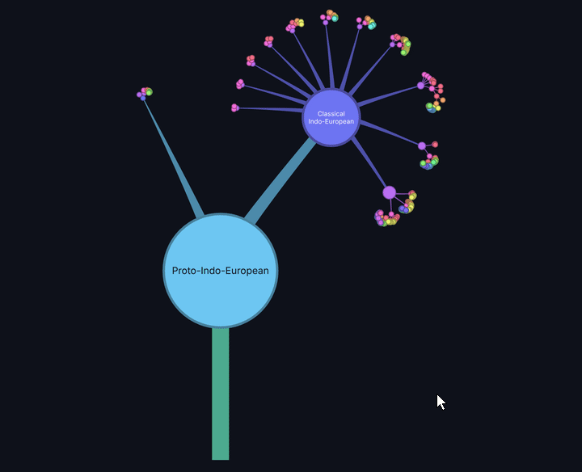

<div align="center">


# TreeFern

**A lightweight, free and open-source editor for cladograms.**

[](https://github.com/DocRountree/treefern/actions/workflows/build.yml)
[](https://github.com/DocRountree/treefern/releases/latest)
[](LICENSE)
[](#download)

[](https://github.com/DocRountree/treefern/releases/latest/download/TreeFern-Setup.exe)
[](https://github.com/DocRountree/treefern/releases/latest/download/TreeFern-x86_64.AppImage)
[](https://docrountree.github.io/treefern/)


</div>

TreeFern is written in C++ with Qt 6. Cladograms are stored as plain JSON files: every edit is saved immediately, and changes made to the file by other programs are picked up live.

You can also [use TreeFern in your browser](https://docrountree.github.io/treefern/), on desktop or phone, with no install. The web version opens the same JSON files, includes the sample trees, and supports editing by mouse, keyboard or touch.

## Contents

- [Features](#features)
- [Download](#download)
- [Building from source](#building-from-source)
- [Usage](#usage)
- [File format](#file-format)
- [Screenshots](#screenshots)
- [License](#license)

## Features

- **Two layouts**
  - **Standard**: a tapered branching tree in which heavier daughter clades curve away from their mother clade, inspired by the [OneZoom](https://www.onezoom.org/) viewer. Spread, shrink and curl can be adjusted from the keyboard.
  - **Disks**: nested circle packing, with each daughter clade drawn as a disk inside its mother clade.
- **Editing**: add daughter clades, rename clades and attach free-form notes to them, collapse or expand subtrees, delete subtrees, and move a subtree to a new mother clade with cut and paste.
- **Undo and redo** for every edit.
- **Autosave and live sync**: each change is written to disk atomically, and the file is reloaded automatically if another program modifies it.
- **Dynamic labels**: labels too small to read are hidden until you zoom in, and labels reposition themselves to avoid overlapping. Labels can be placed over or beside nodes.
- **Search and navigation**: find clades by name from the side panel, and move around the tree entirely by keyboard or entirely by mouse.
- **Export**: save the current view as a PNG image (at twice screen resolution) or as a scalable SVG.
- **Dark and light themes.**
- **Remembered preferences**: layout, label placement, theme and recently opened files persist between sessions.

## Download

Prebuilt packages are attached to each [release](https://github.com/DocRountree/treefern/releases/latest).

| Platform | File | Notes |
|---|---|---|
| Windows 10/11 (64-bit) | [`TreeFern-Setup.exe`](https://github.com/DocRountree/treefern/releases/latest/download/TreeFern-Setup.exe) | Installer. Installs for the current user and does not require administrator rights. |
| Windows 10/11 (64-bit) | [`treefern-windows.zip`](https://github.com/DocRountree/treefern/releases/latest/download/treefern-windows.zip) | Portable version. Unzip and run `treefern.exe`. |
| Linux (x86-64) | [`TreeFern-x86_64.AppImage`](https://github.com/DocRountree/treefern/releases/latest/download/TreeFern-x86_64.AppImage) | Single self-contained file. Requires glibc 2.35 or newer (Ubuntu 22.04, Debian 12, Fedora 36 or later). |
| All | [`TreeFern-samples.zip`](https://github.com/DocRountree/treefern/releases/latest/download/TreeFern-samples.zip) | Sample cladograms. The Windows packages already include them next to `treefern.exe`. |

**Windows:** the installer is not code-signed, so Windows SmartScreen may show "Windows protected your PC". Click **More info**, then **Run anyway**.

**Linux:** make the AppImage executable,

```sh
chmod +x TreeFern-x86_64.AppImage
```

then run it:

```sh
./TreeFern-x86_64.AppImage
```

macOS packages are not yet supported; macOS users can build from source.

## Building from source

### Requirements

- A C++17 compiler (GCC, Clang or MSVC)
- CMake 3.16 or newer
- Qt 6 with the Widgets and Svg modules

Installing the dependencies:

| System | Command |
|---|---|
| Debian, Ubuntu, Mint | `sudo apt install build-essential cmake qt6-base-dev qt6-svg-dev` |
| Fedora | `sudo dnf install gcc-c++ cmake qt6-qtbase-devel qt6-qtsvg-devel` |
| Arch, Manjaro | `sudo pacman -S base-devel cmake qt6-base qt6-svg` |
| openSUSE | `sudo zypper install gcc-c++ cmake qt6-base-devel qt6-svg-devel` |
| macOS (Homebrew) | `brew install cmake qt` |
| Windows | Install Qt 6 with the [Qt Online Installer](https://www.qt.io/download-qt-installer) and CMake, or use [vcpkg](https://vcpkg.io/). |

### Build

```sh
git clone https://github.com/DocRountree/treefern.git
cd treefern
cmake -B build -DCMAKE_BUILD_TYPE=Release
cmake --build build -j
```

The program is a single source file, so downloading just `main.cpp` and `CMakeLists.txt` into one directory and running the last two commands also works.

## Usage

Start TreeFern from your application menu, by double-clicking the executable, or from a terminal:

```sh
./build/treefern                 # reopen the last file, or show the start prompt
./build/treefern cladogram.json  # open a file, creating it from the sample tree if it does not exist
```

Typical workflow:

1. Click a clade to select it. Its name, position in the tree and notes appear in the side panel.
2. Press **F** to focus the camera on the clade's node.
3. Press the **up arrow** key to select the daughter clade, or the **down arrow** to select the mother clade.
4. Press **A** to add a daughter clade, or **E** to edit the clade's name and notes.
5. To move a subtree, select it and press **X**, then select the new mother clade and press **V**.
6. Press **Ctrl+Z** to undo any mistake.

There is no save command: every change is written to the file as soon as it is made. Use **File > Save As** to continue editing under a new file name.

Sample cladograms are in the [`samples`](samples) directory.

## File format

A cladogram is a JSON object with the id of the root clade and a flat list of clades. Every clade except the root names its mother clade in `parent`.

```json
{
  "root": "a1",
  "nodes": [
    { "id": "a1", "name": "Root Clade", "info": "The big clade.", "collapsed": false },
    { "id": "b2", "parent": "a1", "name": "Daughter Clade 1", "info": "One of the little clades.", "collapsed": false },
    { "id": "c3", "parent": "a1", "name": "Daighter Clade 2", "info": "Another little clade.", "collapsed": true }
  ]
}
```

| Field | Type | Description |
|---|---|---|
| `id` | string | Unique identifier for the clade |
| `parent` | string | Id of the mother clade; omitted for the root |
| `name` | string | Display name |
| `info` | string | Free-form notes, shown in the side panel |
| `collapsed` | boolean | Whether the clade's descendants are hidden |

Because the format is plain JSON, files can be generated or edited by scripts and other tools while TreeFern is open; it reloads them automatically. Clades whose parent chain does not reach the root are ignored when a file is loaded.

## Screenshots

<p align="center">
  
  <br>
  <em>Zooming from Proto-Indo-European into German in <code>samples/indo-european.json</code></em>
</p>

<table>
  <tr>
    <td width="50%"></td>
    <td width="50%"></td>
  </tr>
  <tr>
    <td align="center"><em>Standard layout</em></td>
    <td align="center"><em>Disks layout</em></td>
  </tr>
  <tr>
    <td width="50%"></td>
    <td width="50%"></td>
  </tr>
  <tr>
    <td align="center"><em>Light mode</em></td>
    <td align="center"><em>Labels beside nodes</em></td>
  </tr>
</table>

## License

TreeFern is free software, distributed under the terms of the [GNU General Public License, version 3](https://www.gnu.org/licenses/gpl-3.0.html). See [LICENSE](LICENSE) for the full text.

TreeFern uses the [Qt](https://www.qt.io/) toolkit, which is available under the GNU GPL and LGPL. The Windows and Linux packages include unmodified Qt libraries.
